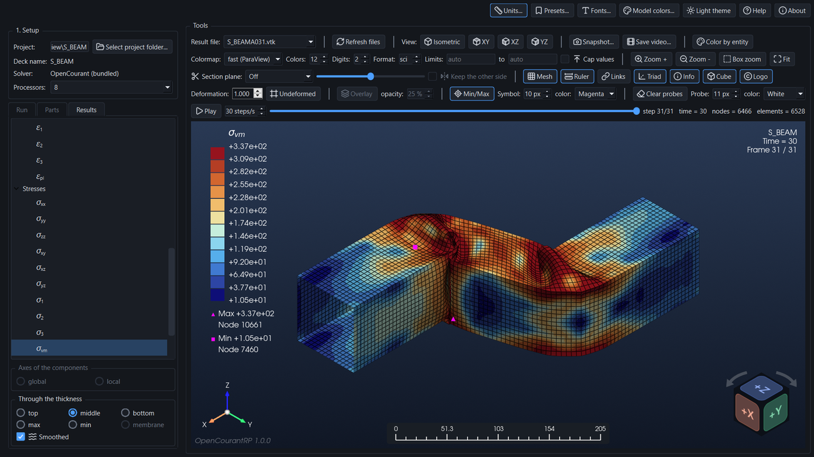

# OpenCourantRP

**OpenCourant Run and Postprocess**: a small Windows desktop app that runs an
[OpenCourant](https://opencourant.org) deck pair and shows the resulting `.vtk` files with PyVista,
embedded in the same window.



## Install

Download `OpenCourantRP-Setup-<version>.exe` from the [Releases page](https://github.com/CAMLAB-UChile/OpenCourantRP/releases) and run it (Windows 64-bit). The wizard lets you choose the install
folder (per-user by default, or all users if you accept the admin prompt) and optionally creates a
desktop shortcut. The OpenCourant solver is included, so no Python and no separate solver install are
needed. Uninstall from Windows Settings > Apps.

To run the code instead of the installer, see *Run from source* below.

## Features

- **Run** an OpenCourant deck pair (`NAME_0000.rad` / `NAME_0001.rad`), or a single combined deck (engine block first, starter from
  `/BEGIN`), with the bundled solver, with a live log.
- **Compressed results** (`/ANIM/GZIP`, `NAMEA###.gz`): kept in the run; the Results tab asks whether to decompress and convert All the time steps, Some (a file window that lists only the `.gz` files) or none, and it can ask again later
  (usually the last) to `.vtk`.
- **Results** tab: a tree of every variable. Displacements, velocities and accelerations (*Ux, Uy, Uz, U*, *Vx, Vy, Vz, V*, *Ax, Ay, Az, A*), contact forces (*Fx, Fy, Fz, F*),
  strains (components, principal values, equivalent plastic strain) and stresses (components, principal
  values, von Mises, maximum shear), damage, temperature, specific energy, hourglass energy, pressure, density, element time step, nodal time step and added mass, with symbols and subscripts in the colour-bar title.
- **Through the thickness** (top, middle, bottom, max, min) for shell stresses and strains, and **global or
  local axes** for the tensor components (the solver writes them in the local axes of each element).
- **Solid elements** (hexahedra, tetrahedra, ...): the same stresses, strains, von Mises stress, specific energy and time step,
  one value per element in the global axes; models with shells and solids share one colour scale.
- **Parts** tab: show or hide each part of the model; the colour range follows the parts that are shown.
- Colour bar: colormap (coolwarm, vik, RdYlBu, RdBu, jet, turbo, inferno, ParaView fast), 2 to 24 colours,
  limits, caps for values out of range, **min/max markers**, **deformation scale**, an **undeformed** view and a translucent **undeformed overlay** with adjustable opacity.
- **Probes** (right click): the value at the nearest node, or inside the element for unsmoothed results.
- **Model colors** (background plain or gradient, triad, entities): a fixed color for rigid bodies, springs and rigid walls (they have no result), a **Color by entity** switch that
  paints shells, solids and the others each in its own color, and a color for the mesh edges; the background, the triad colors (and the sphere at its origin) and the look of the view cube can be changed too; presets keep them all.
- On-screen **ruler** that follows the zoom, **model information** (name, time, frame), a **view cube** (drag it to turn the
  model, click a face, edge or corner), an axes triad and a logo, each switched on and off by a button; optional **units**
  for the dimensions, times and the results, a choice of **digits** and **format** (sci/dec) for the color bar numbers,
  **fonts** for every text of the view, and **presets** that store a whole layout under a name.
- **Zoom tools**: Zoom +, Zoom -, **box zoom** (drag a rectangle) and **Fit** to the whole model, besides the
  mouse wheel.
- **Snapshots** to PNG, JPEG, TIFF or PDF with a quality multiplier, **video** to MP4 or GIF, view buttons
  (isometric, XY, XZ, YZ), **Play**, and a light and a dark theme.
- A **Help** button opens the manual (`docs/manual.md`, also built as one dark-mode HTML page).

The full description of every control is in the [user manual](docs/manual.md).

## Workflow

1. **Select project folder**: the folder holding `NAME_0000.rad` and `NAME_0001.rad`. Both decks must
   share the same `NAME`, otherwise the app reports an error. Existing `.vtk` results load at once.
2. **Run** (the Run tab): the bundled solver is used; choose the number of processors first. **Stop** ends
   the whole run.
3. **Results**: pick a time step (slider or file list) and a variable in the Results tab; hide parts in the
   Parts tab. The toolbar groups the controls by purpose: result file; view, animation and output; colour
   bar, display and zoom; section plane and the buttons Mesh, Ruler, Links, Triad, Info, Cube and Logo; deformation with the undeformed overlay, min/max and probes.
4. Save a **snapshot** or a **video**, or keep the layout as a **preset**.

## Run from source

For those who prefer to run the code instead of the installer. You need Windows 10/11 64-bit (the solver
executables are Windows-only), Python 3.10 or newer (checked on clean installs with 3.10 and 3.14), and Git.

```
git clone https://github.com/CAMLAB-UChile/OpenCourantRP.git
cd OpenCourantRP
python -m venv .venv
.venv\Scripts\activate
pip install -e .                       # editable: the app looks for the solver in the checkout (see below)
python tools/fetch_solver.py           # downloads the official OpenCourant release into solver/ (about 480 MB)
opencourantrp                          # or: python -m opencourantrp
```

(In PowerShell activate with `.venv\Scripts\Activate.ps1`.)

- **The solver.** The app runs the solver from the `solver/` folder at the root of the checkout, which is why the
  install must be editable (`-e`). `python tools/fetch_solver.py --from C:\path\to\OpenCourant` copies it from a local
  copy instead of downloading. With a normal `pip install .` (not editable) the checkout is not found: set the
  environment variable `OPENCOURANTRP_SOLVER` to a folder that holds `exec\starter_win64.exe` instead.
- **Check the installation:** `python -m opencourantrp.app --selftest result.txt` writes a short report (solver found,
  video encoders, math text) and exits with code 0 when everything is in place.
- **Tests:** `pip install -e ".[dev]"`, then `pytest`.
- **The manual.** The Help button opens `src/opencourantrp/resources/manual.html`, which is part of the repository;
  after editing `docs/manual.md` run `pip install markdown` and `python tools/build_manual.py`.
- **Update:** `git pull`, then `pip install -e .` again if `pyproject.toml` changed.

## Build the installer

The solver is not stored in git (`solver/` is git-ignored). After cloning, the build downloads the
official release into `solver/` automatically if it is missing (or run `fetch_solver.py` yourself, e.g.
with `--from` to use a local copy). The installer needs [Inno Setup 6](https://jrsoftware.org/isinfo.php)
(`winget install JRSoftware.InnoSetup`).

```
python -m venv .venv
.venv\Scripts\pip install -e ".[dev]" pyinstaller
.venv\Scripts\python tools/build_installer.py     # -> dist\OpenCourantRP-Setup-<version>.exe
.venv\Scripts\pytest
```

`tools/make_icon.py` regenerates the application icon. `tools/build_manual.py` (needs `pip install markdown`) turns
`docs/manual.md` into the dark-mode `src/opencourantrp/resources/manual.html` that the Help button opens; run it
after editing the manual or its pictures in `docs/img/`.

`tools/build_exe.py` alone builds just the app folder `dist\OpenCourantRP\`. `fetch_solver.py` keeps
only the double-precision SMP executables, the converters and the runtime libraries (about 480 MB) and
verifies the SHA-256 when it downloads. `OPENCOURANTRP_SOLVER` can point to any other solver folder.

## Contributing and support

OpenCourantRP is developed by a single maintainer and does not accept pull requests or issues on GitHub (both are turned off).
You are welcome to fork the project under the terms of the AGPL-3.0-or-later license.

Comments, questions, bug reports and feature requests are welcome in the
[Discussions](https://github.com/CAMLAB-UChile/OpenCourantRP/discussions) section. For a bug report, please include the
OpenCourantRP version, the Windows version, the deck you ran and the log of the Run tab. More information:
<https://camlab.cl/software/OpenCourantRP/>.

## License

GNU AGPL v3, the same license as OpenCourant. See [LICENSE](LICENSE). The solver itself is not part of
this repository; it is embedded in the installer at build time.

## Third-party

The line icons in `src/opencourantrp/resources/icons/` are from [Lucide](https://lucide.dev) (ISC license, see `LICENSE-lucide.txt` there).
