# OpenCourantRP User Manual

**OpenCourantRP** (OpenCourant **R**un and **P**ostprocess) runs an [OpenCourant](https://opencourant.org) deck pair and shows the results in the same window. It is a Windows desktop program: the installer includes the solver, so no Python and no separate solver installation are needed.

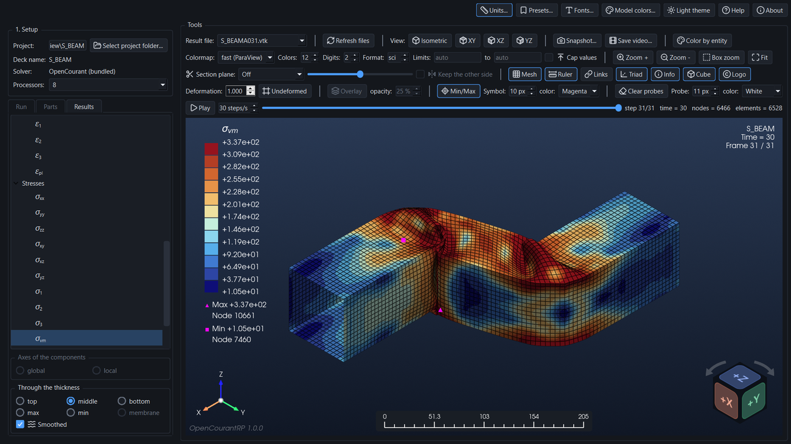

[TOC]

## 1. Installation

There are two ways to get OpenCourantRP. Both give the same program.

### With the installer (recommended)

Download `OpenCourantRP-Setup-<version>.exe` from the [Releases page](https://github.com/CAMLAB-UChile/OpenCourantRP/releases) of the project and run it (Windows 10/11, 64-bit). The wizard asks for the install folder (for the current user by default, or for all users if you accept the administrator prompt) and can create a desktop shortcut. The OpenCourant solver is included, so no Python and no separate solver installation are needed. To remove the program, use *Windows Settings > Apps*. Your saved settings (section 14) are kept in the registry and are not removed.

### From the source code

Use this route to run, modify or build the program yourself. You need Windows 10/11 (64-bit, the solver executables are for Windows only), **Python 3.10 or newer (checked on clean installs with 3.10 and 3.14)** and **Git**. In a command window:

```
git clone https://github.com/CAMLAB-UChile/OpenCourantRP.git
cd OpenCourantRP
python -m venv .venv
.venv\Scripts\activate
pip install -e .
python tools/fetch_solver.py
opencourantrp
```

1. `pip install -e .` installs the program and everything it needs (PySide6, PyVista, NumPy, Pillow, imageio and others). Use the *editable* form (`-e`): the program looks for the solver in the `solver` folder of the checkout.
2. `python tools/fetch_solver.py` downloads the official OpenCourant release into `solver` (about 480 MB are kept). If you already have OpenCourant on the PC, `python tools/fetch_solver.py --from C:\path\to\OpenCourant` copies it instead. To use a solver kept somewhere else, set the environment variable `OPENCOURANTRP_SOLVER` to the folder that holds `exec\starter_win64.exe`.
3. `opencourantrp` (or `python -m opencourantrp`) starts the program.
4. `python -m opencourantrp.app --selftest result.txt` checks the installation: it writes a short report (solver found, video encoders, math text) and finishes with exit code 0 when all is well.

To run the tests, install the development extras with `pip install -e ".[dev]"` and run `pytest`.

### Building the installer yourself

The installer is built with PyInstaller and [Inno Setup 6](https://jrsoftware.org/isinfo.php) (`winget install JRSoftware.InnoSetup`). With the virtual environment active and the solver in place:

```
pip install pyinstaller
python tools/build_installer.py
```

The result is `dist\OpenCourantRP-Setup-<version>.exe`; `python tools/build_exe.py` alone builds just the program folder `dist\OpenCourantRP`. The Help button opens `src\opencourantrp\resources\manual.html`, which is made from this manual with `python tools/build_manual.py` (it needs `pip install markdown`).

## 2. The window

The window has three areas:

- **Left panel.** *1. Setup* (project, solver, processors) and, below it, three tabs: **Run**, **Parts** and **Results**.
- **Tools** (top right). Four rows of controls grouped by purpose, separated by vertical bars, and the time slider.
- **Model view** (bottom right). The 3D picture of the results, with the color bar (top left), the model information (top right), the axes triad (bottom left), the ruler (bottom center), the view cube (bottom right) and the logo (bottom left corner).

The buttons at the very top right are **Units…**, **Presets…**, **Fonts…**, **Model colors…**, the **theme** switch (light/dark), **Help** and **About**.

## 3. Setup and Run

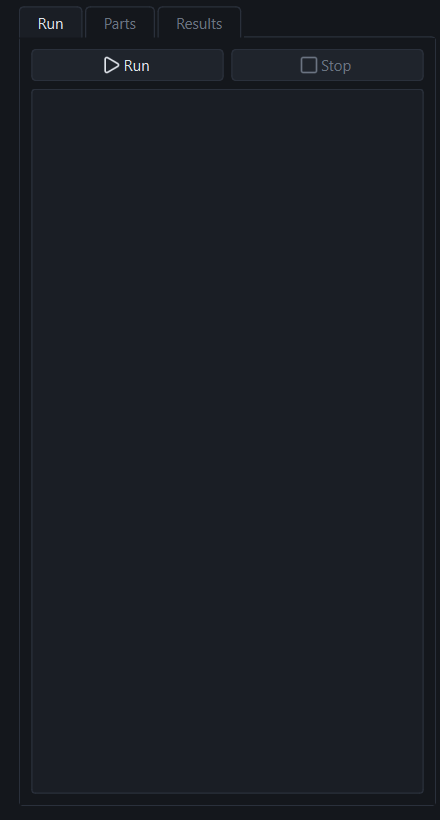

1. **Select project folder…** Choose the folder that holds `NAME_0000.rad` (starter deck) and `NAME_0001.rad` (engine deck). Both decks must have the same `NAME`; otherwise the program reports an error. A **single combined deck** also works: one `NAME_0000.rad` with the engine block first (`/RUN`, `/ANIM`, ..., `/END/ENGINE`) and the starter from `/BEGIN` on, as written by some HyperMesh versions, and no `NAME_0001.rad` in the folder. The run splits it into a starter and an engine deck in the `rp_run` subfolder (adding the `#RADIOSS STARTER` and `#RADIOSS ENGINE` first lines the solver needs); your file is not changed. The engine block must come before `/BEGIN`.
2. **Solver.** The bundled OpenCourant is used automatically.
3. **Processors.** From 1 up to the number of logical processors of the PC.
4. **Run** writes `run_first.bat` and `run_deck.bat` into the project folder and starts the run. The log shows the output of the starter, the engine and the converter while they work. **Stop** ends the whole run.

If the folder already holds `.vtk` result files, they are loaded as soon as the project is opened; you do not need to run again.

**Compressed results.** A run made with `/ANIM/GZIP` leaves compressed `NAMEA###.gz` files instead of `.vtk` files: see *Compressed results (`/ANIM/GZIP`)* below. Play, its speed and **Save video…** are greyed out while fewer than two `.vtk` files are loaded, because a single step is not an animation.

### Compressed results (`/ANIM/GZIP`)

When the engine deck has the card `/ANIM/GZIP`, the engine writes its animation files compressed (`NAMEA001.gz`, `NAMEA002.gz`, …), which takes much less disk space. RP keeps the card in the run (your deck is never modified) and does **not** convert these files by itself, because the converter that makes the `.vtk` files cannot read them. At the end of the run the log says how many compressed files were kept. Then:

1. Open the **Results** tab. If some compressed time steps have no `.vtk` yet, a box asks what to do. It appears once per folder, when the run ends with the Results tab in front, or the first time you open that tab; the same happens with a folder copied from another PC that holds only `.gz` files.
2. Choose one of three buttons:
   - **All** decompresses and converts every pending time step.
   - **Some** opens a file window that shows only the compressed files of the run (`NAMEA*.gz`, nothing else; Ctrl or Shift click to pick several). Only the steps you choose are converted, for example the last one, or every tenth.
   - **Cancel** converts nothing.
3. A progress window shows the work. Each file is decompressed to a temporary file, converted to `NAMEA###.vtk` next to it, and the temporary file is deleted. The `.gz` files are kept. When it ends the `.vtk` files open in the view.

**Asking again.** Cancel is not final: while compressed time steps are still not converted, a button at the top of the Results tab reads *N compressed time step(s) not converted. Convert…*, and the **Compressed files…** button of the Run tab is enabled. Either one opens the same All / Some / Cancel box, for the steps that are still pending (steps already converted are not offered again). Both disappear when every step has its `.vtk` file.

### What the engine deck must write

OpenCourantRP shows the **animation files** of the engine (`NAMEA001`, `NAMEA002`, …, converted to `.vtk` after the run). The engine deck (`NAME_0001.rad`) must therefore ask for them with `/ANIM` cards. `/H3D` cards (for example in a deck exported from HyperMesh) are ignored: the run uses a copy of the engine deck without them, so no `.h3d` file is written, and a warning says how many cards were skipped. `/ANIM/GZIP` is kept (see below). Your deck is not modified. If the deck has no `/ANIM` cards at all, the run copy gets the standard block below (80 frames from 0 to the end time of `/RUN`, one warning line tells you), so a Radioss deck runs without editing it. Write your own `/ANIM` cards if you want other frames or variables: when the deck has any, nothing is added. Add, for example:

```
/ANIM/DT
0. 0.5
/ANIM/ELEM/EPSP
/ANIM/ELEM/VONM
/ANIM/SHELL/TENS/STRESS/3
/ANIM/SHELL/TENS/STRAIN/3
/ANIM/SHELL/TENS/STRESS/UPPER
/ANIM/SHELL/TENS/STRESS/LOWER
/ANIM/SHELL/TENS/STRAIN/UPPER
/ANIM/SHELL/TENS/STRAIN/LOWER
/ANIM/SHELL/TENS/STRESS/MEMB
/ANIM/SHELL/TENS/STRAIN/MEMB
/ANIM/SHELL/EPSP/UPPER
/ANIM/SHELL/EPSP/LOWER
/ANIM/VECT/DISP
/ANIM/VECT/VEL
/ANIM/VECT/CONT
```

(`/ANIM/DT` is the output interval, here every 0.5 time units; `STRESS/3` is the centre integration point of a 5-point shell, `/ANIM/SHELL/TENS/STRESS/MEMB` and `/STRAIN/MEMB` write the membrane tensors (the *membrane* choice), and `/ANIM/VECT/CONT` writes the contact forces, plotted as *F*.)

### Which cards lead to which plots

`/ANIM/DT` only says *when* the files are written. Each result in the Results tab needs its **own** card: without it the file does not contain the result and the variable is greyed out (or, for Damage, Contact forces and Element data, not listed). A card that is missing never stops the run; it only removes the plots that depend on it.

| Card in the engine deck | Written to the `.vtk` as | Plots it gives |
|---|---|---|
| `/ANIM/VECT/DISP` | `Displacement` (nodes) | *U*<sub>x</sub>, *U*<sub>y</sub>, *U*<sub>z</sub>, *U*; also the **Deformation**, **Undeformed** and **Overlay** buttons |
| `/ANIM/VECT/VEL` | `Velocity` (nodes) | *V*<sub>x</sub>, *V*<sub>y</sub>, *V*<sub>z</sub>, *V* |
| `/ANIM/VECT/ACC` | `Acceleration` (nodes) | *A*<sub>x</sub>, *A*<sub>y</sub>, *A*<sub>z</sub>, *A* (the group is listed only if present) |
| `/ANIM/VECT/CONT` | `Contact_Forces` (nodes) | *F*<sub>x</sub>, *F*<sub>y</sub>, *F*<sub>z</sub>, *F* (the group is listed only if present) |
| `/ANIM/ELEM/VONM` | `2DELEM_Von_Mises` | σ<sub>vm</sub> at *middle* (and *membrane*) when the file has no stress tensors |
| `/ANIM/ELEM/EPSP` | `2DELEM_Plastic_Strain` | ε<sub>pl</sub> at *middle* |
| `/ANIM/SHELL/TENS/STRESS/3` | `2DELEM_Stress_(layer__3)_` | σ components, σ<sub>1..3</sub>, σ<sub>vm</sub>, τ<sub>max</sub> at *middle* |
| `/ANIM/SHELL/TENS/STRAIN/3` | `2DELEM_Strain_(layer__3)_` | ε components and ε<sub>1..3</sub> at *middle* |
| `/ANIM/SHELL/TENS/STRESS/UPPER` and `/LOWER` | `2DELEM_Stress_(upper)` and `(lower)` | the same stress variables at *top* and *bottom* |
| `/ANIM/SHELL/TENS/STRAIN/UPPER` and `/LOWER` | `2DELEM_Strain_(upper)` and `(lower)` | the same strain variables at *top* and *bottom* |
| `/ANIM/SHELL/EPSP/UPPER` and `/LOWER` | `2DELEM_Plastic_Strain_Upper` and `_Lower` | ε<sub>pl</sub> at *top* and *bottom* |
| `/ANIM/SHELL/EPSP/ALL` | `2DELEM_Plast_Strn_Layer___1_` … `___5_` (every integration point; `_Upper` and `_Lower` are layers 5 and 1) | ε<sub>pl</sub> at *middle* (layer 3) when `/ANIM/ELEM/EPSP` is not there |
| `/ANIM/SHELL/TENS/STRESS/MEMB` and `/STRAIN/MEMB` | `2DELEM_Stress_(membrane)` and `2DELEM_Strain_(membrane)` | the *membrane* choice of the stress and strain components, principal values and σ<sub>vm</sub>, τ<sub>max</sub> (without these cards, *membrane* works only for σ<sub>vm</sub> and ε<sub>pl</sub>) |
| `/ANIM/SHELL/DAMA` | `2DELEM_MAX_DAMAGE_ELEMENT` | Damage (listed only if present) |
| `/ANIM/NODA/DT` | point array `Time_Step` | Nodal time step (Nodal data group, listed only if the file has real values: see *The element time step and `/DT/NODA`*) |
| `/ANIM/NODA/TEMP` | point array `Nodal_Temperature` | Temperature (Nodal data group, listed only if present; thermal models with `/HEAT/MAT`) |
| `/ANIM/NODA/DMAS` | point array `Mass_Change` | Added mass (Nodal data group, listed only if present): the mass that mass scaling (`/DT/NODA/CST`) added at each node |
| `/ANIM/ELEM/HOURG` | `2DELEM_Hourglass_Energy_per_unit_mass`, `3DELEM_Hourglass_Energy_per_unit_mass` | Hourglass energy (Element data group, listed only if present; zero for fully integrated elements) |
| `/ANIM/ELEM/ENER` | `2DELEM_Specific_Energy` | Specific energy (Element data group, listed only if present) |
| `/ANIM/ELEM/P` | `2DELEM_Pressure`, `3DELEM_Pressure` | Pressure (Element data group, listed only if present; the main result of an ALE fluid) |
| `/ANIM/ELEM/DENS` | `2DELEM_Density`, `3DELEM_Density` | Density (Element data group, listed only if present) |
| `/ANIM/ELEM/DT` | `2DELEM_Element_Time_Step` | Time step (Element data group, listed only if present; see *The element time step and `/DT/NODA`*) |
| `/ANIM/BRICK/TENS/STRESS/000` and `/STRAIN/000` | `3DELEM_Stress` and `3DELEM_Strain` (9 numbers per solid element, in the global axes, skew 000) | σ and ε components, principal values, σ<sub>vm</sub>, τ<sub>max</sub> of **solids** |
| `/ANIM/BRICK/VONM` | `3DELEM_Von_Mises` | σ<sub>vm</sub> of solids when the file has no stress tensor |
| `/ANIM/BRICK/EPSP` or `/ANIM/ELEM/EPSP` | `3DELEM_Plastic_Strain` | ε<sub>pl</sub> of solids |
| `/ANIM/ELEM/ENER`, `/ANIM/ELEM/DT` | `3DELEM_Specific_Energy`, `3DELEM_Element_Time_Step` | Specific energy and Time step of solids |

**`/H3D` cards are ignored.** OpenCourantRP is not built around HyperMesh and HyperView, so it does not read `.h3d` files. If the engine deck has `/H3D` cards (decks exported from HyperMesh have them), the run uses a copy of the deck without them, so no `.h3d` file is written and the H3D library is not needed; a warning in the Run log says how many cards were skipped. Your deck is not changed. Only the `/ANIM` cards in the table above lead to plots.

**`/ANIM/GZIP` is kept.** This card makes the engine compress its animation files (`NAMEA001.gz`, …). The converter that runs after the engine cannot read them, so the run only reports how many compressed files it found; RP then asks, in the Results tab, whether to decompress and convert all the steps or only some (see *Compressed results (`/ANIM/GZIP`)* in section 3). (`/ANIM/GZIP` does not compress the `.vtk` files: those are written by the conversion.)

Always in the file, with no card: the mesh, the node and element numbers, the part numbers (Parts tab) and the erosion status (eroded elements disappear).

A few consequences:

- ***max* and *min*** compare top, middle and bottom, so they need the three of them: the `/3`, `/UPPER` and `/LOWER` cards. With only some of them, those two buttons are disabled.
- **Top, middle, bottom** each work as soon as their own cards are there. A place the file has no data for is disabled, and RP falls back to *middle* if it was selected.
- **No `/ANIM/VECT/DISP`:** the model is drawn in the shape the file holds, and the Deformation, Undeformed and Overlay buttons have no effect. U is greyed out.
- **Only `ELEM/VONM` and `ELEM/EPSP`** (and no `SHELL/TENS` cards): you get σ<sub>vm</sub> and ε<sub>pl</sub> at *middle* only, as one value per element and not split through the thickness. No stress or strain components, no principal values, no τ<sub>max</sub>.
- **`/ANIM/SHELL/EPSP/ALL` instead of `/ANIM/ELEM/EPSP`:** ε<sub>pl</sub> at *middle* is read from layer 3. The two are identical (checked on a run with both cards: the element value equals layer 3 exactly, and `_Upper` equals layer 5), so nothing is lost; with 5 integration points layer 3 is the centre.
- **`STRESS/3` assumes a shell with 5 integration points** (see the note under *Through the thickness*).
- **Solids:** when the starter deck has `/BRICK`, `/BRIC20`, `/TETRA4`, `/TETRA10` or `/PENTA6` elements and the engine deck has no `/ANIM` cards, the standard block also asks for the solid stress, strain, von Mises stress and plastic strain (`/ANIM/BRICK/...`). Without `/ANIM/VECT/DISP` the model is drawn in the shape of the file, as for shells.

Two sets to start from:

- *Velocities, von Mises stress and plastic strain only* (a light output, as in the box beam example): `/ANIM/DT`, `/ANIM/VECT/VEL`, `/ANIM/ELEM/VONM`, `/ANIM/ELEM/EPSP`.
- *Everything RP can plot for shells*: the block listed above, plus `/ANIM/SHELL/DAMA` if the material writes damage.

## 4. Choosing what is plotted: the Results tab

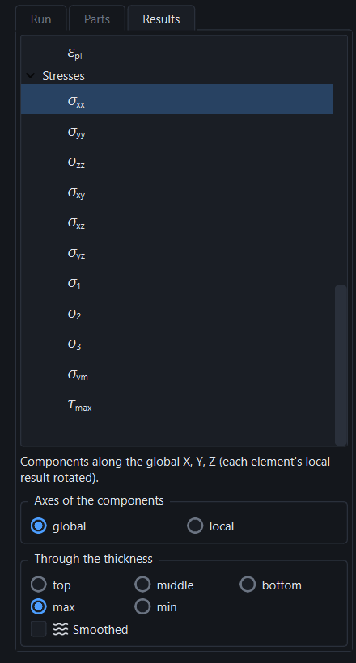

The tab lists every variable that can be plotted. Click one and the view changes at once. Names greyed out are not in the result file (Damage is simply not listed in that case).

| Group | Variables |
|---|---|
| **Displacements** | *U*<sub>x</sub>, *U*<sub>y</sub>, *U*<sub>z</sub> (components) and *U* (total) |
| **Velocities** | *V*<sub>x</sub>, *V*<sub>y</sub>, *V*<sub>z</sub> and *V* (total) |
| **Accelerations** | *A*<sub>x</sub>, *A*<sub>y</sub>, *A*<sub>z</sub> and *A* (total); listed only when the engine deck writes `/ANIM/VECT/ACC` |
| **Contact forces** | *F*<sub>x</sub>, *F*<sub>y</sub>, *F*<sub>z</sub> and *F* (total); listed only when the engine deck writes `/ANIM/VECT/CONT` |
| **Strains** | ε<sub>xx</sub>, ε<sub>yy</sub>, ε<sub>zz</sub>, ε<sub>xy</sub>, ε<sub>xz</sub>, ε<sub>yz</sub>; the principal strains ε<sub>1</sub>, ε<sub>2</sub>, ε<sub>3</sub>; the equivalent plastic strain ε<sub>pl</sub> |
| **Stresses** | σ<sub>xx</sub>, σ<sub>yy</sub>, σ<sub>zz</sub>, σ<sub>xy</sub>, σ<sub>xz</sub>, σ<sub>yz</sub>; the principal stresses σ<sub>1</sub>, σ<sub>2</sub>, σ<sub>3</sub>; the von Mises stress σ<sub>vm</sub>; the maximum shear stress τ<sub>max</sub> = (σ<sub>1</sub> − σ<sub>3</sub>)/2 |
| **Damage** | The element damage written by the solver (for example the Gurson damage). It is listed only when the result file contains it |
| **Nodal data** | *Nodal time step* (`/ANIM/NODA/DT`), *Temperature* (`/ANIM/NODA/TEMP`) and *Added mass* (`/ANIM/NODA/DMAS`), one value per node; each is listed only when the file contains it, and the time step only when the run used `/DT/NODA`. Nodes that belong only to rigid bodies or springs have no value and are left uncolored (see *The element time step and `/DT/NODA`*) |
| **Element data** | *Specific energy* (`/ANIM/ELEM/ENER`), *Time step* (`/ANIM/ELEM/DT`) and *Hourglass energy* (`/ANIM/ELEM/HOURG`), *Pressure* (`/ANIM/ELEM/P`) and *Density* (`/ANIM/ELEM/DENS`), one value per element (shell or solid); each is listed only when the file contains it. They do not vary through the thickness. Pressure uses the stress unit and density `mass/length^3`. Trusses and springs are drawn in their fixed color and carry no result |

The principal values are sorted from the largest (1) to the smallest (3). The color bar title uses the same symbols.

### Through the thickness

Stresses, strains and the plastic strain of a **shell** are stored at several places through the thickness. Choose one:

- **top** and **bottom**: the outer surfaces (the stress there is the value at the outermost integration point; the strain is extrapolated to the surface);
- **middle**: the centre integration point of the thickness (for the von Mises stress too, computed from that layer's tensor; only a run without tensors falls back to the solver's own von Mises, which is the mean through the thickness);
- **max** and **min**: the largest and the smallest of top, middle and bottom, element by element (the sign is kept);
- **membrane**: the tensor averaged through the thickness, when the run wrote it (the engine writes it with `/ANIM/SHELL/TENS/STRESS/MEMB` and `/ANIM/SHELL/TENS/STRAIN/MEMB`). It is the one the solver's own von Mises is made from, and it does not depend on the number of integration points. The button is enabled only when the file has it. Without it, *membrane* still works for σ<sub>vm</sub> (the solver's own von Mises, from `/ANIM/ELEM/VONM`, is the membrane one) and for ε<sub>pl</sub> (which has no membrane value of its own and shows the *middle* one); all the tensor components stay greyed out. A run that wrote only the membrane tensor shows it as the *middle*. Plastic strain has no membrane value.

These buttons (except *membrane*, which needs the data) are disabled for displacements, velocities, damage and the element data, which do not vary through the thickness.

> **Note.** *Middle* is read from the centre layer among the layers the file holds: layer 3 of 5 for a shell with **N = 5** integration points through the thickness, and layer 1 for **N = 1** (where all places are the same; `/ANIM/SHELL/TENS/STRESS/ALL` then writes `(layer__1)_`, `(upper)` and `(lower)`). Another N has no exact centre layer. OpenCourantRP reads N from the starter deck and shows a warning under the tree when a visible part has another value.

**Where N is set.** N is the number of integration points **through the thickness** (one row of points from the bottom face to the top face at each place of the shell), not a number per layer. It is a field of the shell property in the **starter deck** (`NAME_0000.rad`), on the `/PROP/SHELL/prop_ID` card (also written `/PROP/TYPE1`): it is the first field of the last data line of the card. Each part refers to a property, so N is set per property. For example:

```
/PROP/SHELL/1
sheet_1.7
        24
                                                      (blank line: hm, hf, hr, dm, dn)
         5                           2.5                                       1         1
```

| Line of the card | Fields |
|---|---|
| title | `prop_title` |
| 1st data line | `Ishell`, `Ismstr`, `Ish3n`, `Idril`, `Ipinch`, `P_thickfail` (here `Ishell` = 24) |
| 2nd data line | `hm`, `hf`, `hr`, `dm`, `dn` |
| 3rd data line | **`N`**, `Thick`, `Ashear`, `Ithick`, `Iplas` (here N = 5, thickness 2.5) |

The fields are 10 characters wide. N = 0 (the default) means global integration for material LAW1 and N = 3 for the other materials; N = 1 is the membrane behaviour. See `/PROP/TYPE1 (SHELL)` in the Altair Radioss Reference Guide and *Integration Points Throughout the Thickness* in the Theory Manual.

The card may be in a file that the starter deck includes with a line `#include props.txt` (as in the `sbeam_crash` example): OpenCourantRP follows those lines, looking for the file next to the deck that includes it.


### Axes of the components

The solver writes the tensor components in the **local axes of each element**, not in the global X, Y, Z. The option **Axes of the components** converts them:

- **global** (default): the components are rotated to the global axes, so that σ<sub>xx</sub> is the stress along X everywhere;
- **local**: the numbers exactly as they are in the file. Neighboring elements have different local axes, so this view looks noisy on an unstructured mesh.

The local axes are rebuilt from the nodes of each element, on the shape the element has in the result file (the axes follow the element as it deforms): the normal comes from the node order (right-hand rule), x runs along side 1→2 in a 3-node shell and along the bisector of the two diagonals (1–3 and 4–2) in a 4-node shell, and y = normal × x. This is the convention the solver and the sibling program OpenCourantLab use; it was checked against the known stress of a pressurised tube (triangles and skewed quads). The option has no effect on the principal values, σ<sub>vm</sub>, τ<sub>max</sub>, ε<sub>pl</sub>, displacements or velocities, because those do not depend on the axes.

### Solid elements and mixed models

A solid (hexahedron, tetrahedron, wedge, pyramid) has one stress tensor, one strain tensor and one value of each other result per element, written by the solver in the **global axes**. The tree is the same as for shells, with these differences:

- **Through the thickness** and **Axes of the components** do not apply to solids. In a file with solids only, both groups are greyed out.
- In a file with **shells and solids** each element reads its own arrays (`2DELEM_...` for shells, `3DELEM_...` for solids) and the colors share one scale. The choice through the thickness and the axes act on the shells only; solids show their element value. A note under the tree says so.
- A solid is drawn as its outer surface, so the inside is hidden. Use the section plane to cut it open: it keeps the elements on one side of the plane (whole elements, by their centers), so the cut is stepped, not smooth.
- A 20-node solid (`/BRIC20`) and a thick shell (`/SHEL16`) are written by the converter as 8-node hexahedra; there are no mid-side nodes in the view.
- There is no damage variable for solids, and the principal values, σ<sub>vm</sub> and τ<sub>max</sub> are computed from the tensor as for shells.

### Smoothed

Element results (stresses, strains, plastic strain, damage) are constant in each element. **Smoothed** averages them at the nodes, using the elements around each node, to give a continuous picture. It has no effect on displacements and velocities, which are already nodal.

## 5. Parts

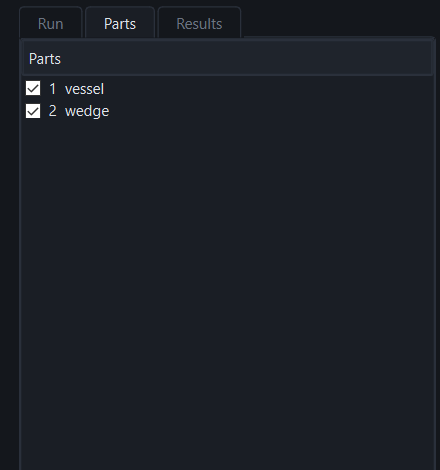

When the model has several parts, the **Parts** tab lists them (names come from the starter deck), each with a check box. Uncheck a part to hide it.

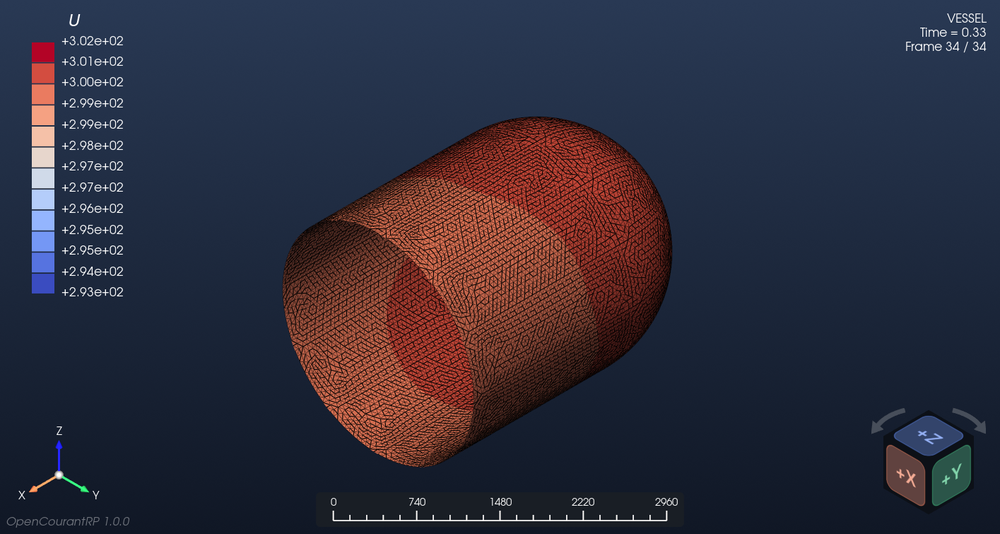

The color bar range follows the parts that are shown, so you can read the results of one part without the others stretching the scale. The chosen parts stay hidden while you move through the time steps; they are shown again when you open another project. When the model has rigid walls (such as `/RWALL`), the list ends with a **Rigid walls** entry that shows or hides all of them; a wall is not a part of the model, so hiding a real part never hides the walls. The lines of a rigid body (`/RBODY`) belong to the part whose elements they touch, so hiding that part hides its rigid body too.

## 6. The Tools area

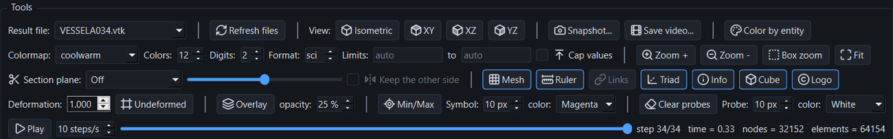

**Row 1: Result file, view and output.** **Result file** is the `.vtk` file (time step) on screen, and **Refresh files** looks for new files, for example while a run is going. The **slider** below the toolbar moves through the steps; to its left, **Play / Pause** steps through the results at the chosen *steps/s* (the real rate is limited by how fast the view can be redrawn, about 10 steps/s), and to its right the step, the time and the numbers of nodes and elements are shown.

- **View**: **Isometric**, **XY**, **XZ** and **YZ**. The view is **orthographic** (no perspective), so panning and rotating never distort the model, and the ruler is exact over the whole view. The mouse rotates (left button), pans (middle) and zooms (wheel) the model.
- **Snapshot…** saves the picture of the view (section 9).
- **Save video…** renders every step with the current variable, view and options into an **MP4** (H.264) or **GIF**.
- **Color by entity** (last of the row): paints every kind of cell in its own color instead of the result; see *Model colors*.

**Row 2: Color bar and display.**

- **Colormap**: coolwarm, vik, RdYlBu, RdBu, jet, turbo, inferno and fast (the ParaView *Fast* map).
- **Colors**: number of colors of the bar, from 2 to 24.
- **Digits** and **Format**: how the numbers of the bar (and the *Max* and *Min* values under it) are written. **Digits** is the number of digits after the point, from 0 to 6 (2 by default). **Format** is **sci** (scientific, with an exponent, `+3.02e+02`) or **dec** (plain decimals, `+301.50`); click its arrows to switch.
- **Limits**: lower and upper limit of the bar. Leave a box empty ("auto") to take that limit from the data.
- **Cap values**: paints the values above the upper limit dark grey (`#383838`) and those below the lower limit light grey (`#9E9E9E`).
- **Zoom**: **Zoom +** and **Zoom -** zoom in and out by a factor of 1.25 per click, about the centre of the view (the mouse wheel zooms too). **Box zoom** switches the tool on: drag a rectangle with the **left** button and the view zooms to that rectangle (it is centred and made to fill the view); the tool then switches itself off, and clicking the button again before dragging cancels it. A click without a drag does nothing. **Fit** fits the whole model into the view, keeping the viewing direction. The zoom is a camera action: it is not stored in presets, and the view buttons (Isometric, XY, XZ, YZ) also fit the model.

**Row 3: Section plane and view items.**

- **Section plane**: *Off*, *Plane normal to X*, *Plane normal to Y* or *Plane normal to Z*. With a plane on, the **slider** moves it across the model, and a label next to it shows its position (in the length unit when one is declared). The elements whose centre is on the lower side of the plane are hidden, so the inside of the model can be inspected; the color bar range follows the part that is shown.
- **Keep the other side** (next to the slider) swaps the two sides: the part that was hidden is shown and the one that was shown is hidden.
- The plane is placed in the model's original coordinates and cuts the model as it is drawn (deformed or not). The cut follows the element boundaries (whole elements are kept or hidden), so the results of each element are exactly the ones in the file. The plane goes back to *Off* when another project is opened. If the plane hides the whole model, the view is left empty and the status line says so.
- **Mesh**, **Ruler**, **Links**, **Triad**, **Info**, **Cube** and **Logo** (one group, after the section plane) are buttons that show or hide an item of the view; a pressed button (blue outline) means the item is shown. The choices are remembered between sessions.
  - **Mesh** draws the element edges.
  - **Ruler** is the on-screen ruler (section 8).
  - **Links** shows or hides the line links of the rigid bodies (`/RBODY`): one line from the master node to each slave node. It is on by default and greyed out when the model has no rigid body. A rigid body made of solid or shell elements is also drawn as the elements it replaces (section 12): with *Links* on the body is semi-transparent so that the links can be seen inside it, and with *Links* off only the opaque body remains.
  - **Triad** is the axes triad at the bottom left, with a small sphere at its origin.
  - **Info** is the model information at the top right: the model name, `Time = …` (with the time unit declared in *Units*) and `Frame n / N`, the current frame over the total number of frames. Its font is set in *Fonts* (*Model information*).
  - **Cube** is the view cube at the bottom right (section 12): drag it to turn the model, click a face, an edge or a corner to look from there, and use its two curved arrows to turn the model in the plane of the screen (45° per click).
  - **Logo** is the faint, slanted *OpenCourantRP* name and version in the bottom left corner; it only appears while a result is shown.

**Row 4: Deformation, extremes and probes.**

- **Deformation** (the deformation scale): multiplies the displacement that deforms the mesh, starting from the original shape. 1 gives the deformed shape stored in the result file. **Undeformed** plots the original shape instead.
- **Overlay** draws the undeformed model, translucent, over the deformed one, to see how far every part has moved. **opacity** (10 to 90 %, 25 % at the start) sets how opaque it is. Only the outer skin is drawn. Eroded elements are included, so you can see where material was lost; hidden parts stay hidden and the section plane applies to it as to the model. Its color is the *Undeformed overlay* swatch of the Entities tab (section 12). The button and the opacity are greyed out while *Undeformed* is pressed and when the file has no `Displacement` (a deck without `/ANIM/VECT/DISP`). Both are remembered between sessions but are not part of the presets (the color is).
- **Min/Max** (a button; pressed = on) marks the maximum (triangle) and the minimum (square) of the plotted variable on the model, with a legend under the color bar: *Max* and *Min* with their value and, below each, the node or element where it is, with the number the deck gives it (`Node 52828`, `Element 21306`; a plotted result of the nodes shows a node, one of the elements an element). **Symbol** and **color** (magenta, cyan or white) control the symbols.
- **Clear probes**, **Probe** and **color** belong to the probe tool (section 7).

## 7. Probes

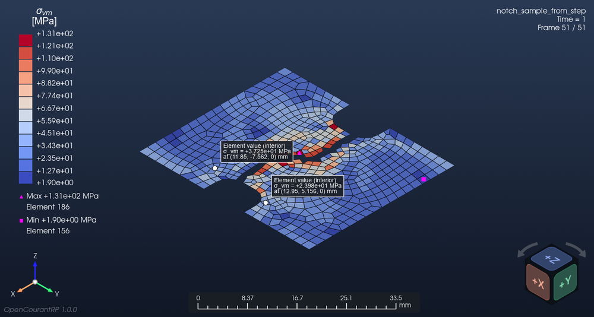

**Right-click** any point of the model to place a probe: a dot with an information box. Right-click on empty space (or press **Clear probes**) to remove them all.

- For a **nodal** result (displacements, velocities, and any smoothed result) the probe reads the value at the **nearest node** ("Node value").
- For an **element** result that is not smoothed it reads the value **inside the element** where you clicked ("Element value (interior)").
- Vectors also list their components. When a length unit is declared, the box gives the position of the probe in the model.

The probe follows its point while you change the time step or the deformation. If its element is deleted by erosion the probe disappears. The dot keeps the same size on screen whatever the mesh, and **Probe size** and **color** change it.

## 8. Ruler

The ruler sits at the bottom middle of the view and always spans **one third of the view width**. Its numbers change when you zoom, so it always shows the real length that its width covers. It uses the length unit of the *Units* window when one is declared. The **Ruler** button switches it on and off; the ruler also appears in snapshots and videos.

## 9. Snapshots

Snapshots and videos draw the view as it is on screen: the color bar, the model information, the triad, the ruler, the view cube and the logo appear in them when their buttons are on, and the colors of *Model colors* are used.

**Snapshot…** opens a *Save snapshot* window. Choose the folder, the name and the type: **PNG**, **JPEG**, **TIFF** or **PDF**. The **Quality** box sets how many times larger than the screen view the picture is drawn (1× to 8×); the window shows the resulting size in pixels. The program remembers the quality of each type. The PDF holds a high-resolution picture of the view (150 dpi at the chosen multiplier).

## 10. Units

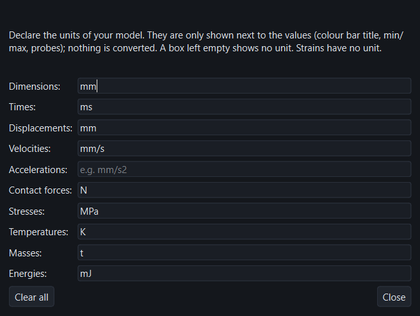

**Units…** lets you write the units of the **dimensions**, **times** (shown in the model information), **displacements**, **velocities**, **accelerations**, **contact forces**, **stresses**, **temperatures**, **masses** and **energies** (strains have none). Specific energy and hourglass energy (per unit mass) show the energy and mass units as `energy/mass`, when both are declared; pressure shows the stress unit and density shows `mass/length^3` (declared masses and dimensions, both needed). They are plain text, for example `mm`, `mm/s`, `MPa`. Where a variable has a declared unit, it is shown on a second line of the color bar title (for example `[MPa]`), after the min/max values and in the probes; dimensions are used by the ruler and the probe position. If you declare nothing, no unit is shown.

## 11. Fonts

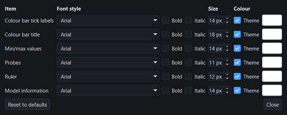

**Fonts…** changes the **style**, **size** and **color** of the texts drawn in the view: color bar tick labels, color bar title, min/max values, probes, the ruler and the model information. The default is what the program used before. The color bar title is drawn with math symbols, so for it only size and color apply.

## 12. Model colors

**Model colors…** chooses the colors of the view that are not the result. It has four tabs; every change applies at once, and each tab has its own reset button. All of them are kept between sessions and are part of the presets.

### Background

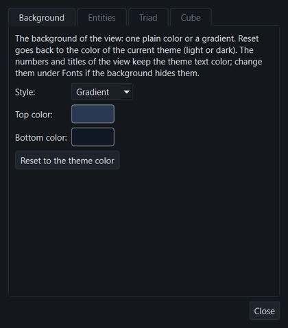

The background of the view is either a **Gradient** (a top and a bottom color) or a **Plain color**. **Reset to the theme color** goes back to the background of the current theme (light or dark). A background you choose stays when you switch theme. The numbers, titles and ruler keep the theme text color, so change them under *Fonts* if the new background hides them.

### Entities

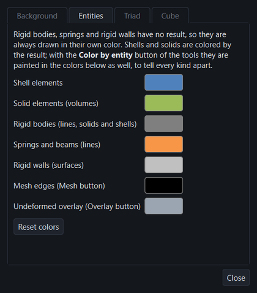

It chooses the color of each kind of cell of the model. It only sets colors; the **Color by entity** button of the Tools (last of row 1) decides when they are used.

The kinds are:

| Kind | What it is | Default |
|---|---|---|
| **Shell elements** | triangles and quads | blue |
| **Solid elements (volumes)** | hexahedra, tetrahedra, wedges, pyramids | green |
| **Rigid bodies (lines, solids and shells)** | line cells with element number 0, and the solid or shell elements a rigid body replaces | gray |
| **Springs and beams (lines)** | line cells with an element number | orange |
| **Rigid walls (surfaces)** | surface cells with element number 0 (`/RWALL`) | light gray |
| **Mesh edges (Mesh button)** | the element edges drawn by the *Mesh* button | black |
| **Undeformed overlay (Overlay button)** | the translucent undeformed model drawn by the *Overlay* button | light gray-blue |

- **Rigid bodies made of solids or shells.** When a `/RBODY` is defined on the nodes of solid or shell elements (a roller, a cylinder, the rigid head of an airbag model), the solver switches those elements off and lists them in the starter output as *deactivated elements from rigid bodies*; the result file marks them as dead from the first frame, like eroded elements. RP does not hide them: a dead solid or shell whose every node is on a rigid link is drawn in the *Rigid bodies* color, so the body keeps its shape and follows its motion, and the *Mesh* button draws its element edges. Elements that really eroded still disappear. While the *Links* button is on, the body is drawn semi-transparent and the lines inside show through; with it off the body is opaque and clean. Hiding the part in the Parts tab hides the body and its links together.
- **Always.** Rigid bodies, springs, beams and rigid walls have no result of their own, so they are drawn in their own color whatever is plotted. They are not part of the color bar: they no longer stretch its range, and the smoothing does not average their zeros into the neighboring nodes. Lines are drawn two pixels wide. They cannot be probed.
- **Color by entity** (button in the Tools). Every kind is painted in its own flat color instead of the result, which helps to tell the parts of the model apart (a rigid body from a spring, a wall from the plate behind it). There is no color bar in this view, and probes do nothing. Click the button again to leave it. **Clicking a variable in the Results tab also leaves it**, so that the click shows the result.
- **Reset colors** restores the defaults. Whether the button is on is kept between sessions and is part of the presets too.
- Nodes are not drawn by OpenCourantRP, so there is no node color.

### Triad

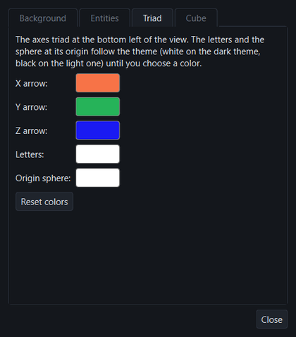

The color of the three arrows (X, Y, Z), of the letters and of the small sphere at the origin of the axes triad at the bottom left of the view. The letters and the sphere follow the theme until you choose a color (white on the dark theme, black on the light one). **Reset colors** restores the defaults (salmon, green and blue arrows, letters and sphere following the theme).

### Cube

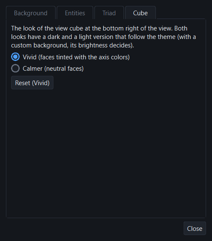

The look of the **view cube** (the **Cube** button of the Tools shows or hides it). **Vivid** (the default) tints each face with the color of its axis (X coral, Y green, Z blue), like the triad; **Calmer** has neutral faces and only the letters carry the axis color. Both have a dark and a light version that follow the theme (with a custom background, its brightness decides). **Reset (Vivid)** goes back to the default.

The cube always shows how the model is turned. The zone under the pointer lights up. **Drag** on it to turn the model; **click** a face to look at it (+X … −Z), the area near an edge for the 45° view of that edge, and the area near a corner for the isometric view of that corner. The two curved arrows above the cube turn the model in the plane of the screen, 45° per click: the left one counterclockwise, the right one clockwise. The cube is also drawn in snapshots and videos.

## 13. Presets

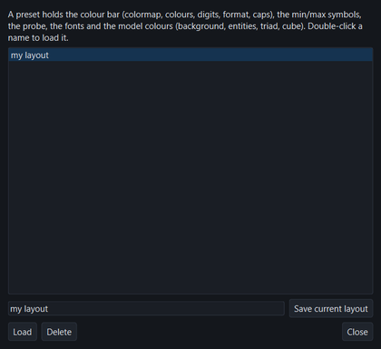

**Presets…** saves the current layout under a name and loads it later. A preset holds the colormap, the number of colors, *Cap values*, *Min/Max* with its symbol size and color, the number of **Digits** and the **Format** of the bar numbers, the probe size and color, all the fonts, the background, entity, triad (with its sphere) and cube look and the state of the *Color by entity* button (the color limits are not part of it, nor are the buttons that show or hide the items of the view). Type a name and press **Save current layout**; to use one, select it in the list and press **Load**; **Delete** removes it.

## 14. Theme

The theme button at the top right switches between the **light** and the **dark** theme, for the whole program and the model view. The choice is remembered.

## 15. Saved settings

The program keeps its settings between sessions (last project, processors, theme, colormap, digits and format, options, which items of the view are shown, fonts, units, model colors, presets, snapshot folder and qualities). They are stored in the Windows registry under `HKEY_CURRENT_USER\Software\OpenCourantRP\OpenCourantRP`. Deleting that key returns everything to the defaults.

## 16. Notes and limits

### The element time step and `/DT/NODA`

An explicit solver advances the whole model by one time step, which cannot exceed the stable step of any element: roughly the element size divided by the speed of sound of its material, times a safety factor. One small or distorted element therefore slows down the entire run. The **Time step** variable shows that value for each shell element, so the lowest values (the blue end of the scale) are the elements that limit the run. In a crash, the step shrinks where elements collapse. Rigid bodies (the line cells) have no element time step and hold 0, which stretches the color scale: set the limits by hand or hide those parts in the Parts tab.

Two different cards deal with the time step:

- **`/ANIM/ELEM/DT`** is an output request: it only makes the engine write each element's time step into the animation files. It does not change how the solver runs.
- **`/DT/NODA/...`** changes the calculation. The engine uses the *nodal* time step method, and its `CST` variants add nodal mass where needed to keep the step at a constant target (**mass scaling**), which makes the run faster at the price of extra mass in the small elements. Other variants reduce the equivalent nodal stiffness (`SET`) or raise the initial nodal mass (`STOP`); see the Radioss Reference Guide.

They interact: without `/DT/NODA` the solver computes a step for every element (the default), and `/ANIM/ELEM/DT` shows them. With `/DT/NODA` it no longer computes element time steps, so `/ANIM/ELEM/DT` writes nothing and **Time step** is not listed. In such a model add **`/ANIM/NODA/DT`**: it writes the *nodal* time step, the step the nodal method computes at each node, which is what limits the run there (plotted as **Nodal time step**; nodes with no value, such as rigid ones, are left uncolored). Without `/DT/NODA` the solver writes only placeholders into that array (0 and huge numbers), so RP does not list the variable. To see the element steps instead, run the model without `/DT/NODA`.

- The tensor results are those written by the solver in the animation files. Strain at the top and bottom is extrapolated by the solver from the outermost integration point and the curvature; the stress at the top and bottom is the value of the outermost integration point.
- The element frames for 4-node shells follow the figure of the Theory Manual; the 3-node frames were checked against the data of a model with 3-node shells (the global field becomes smooth, whereas the local one is not).
- Rigid bodies and springs (line cells) have no stress: in a model with solids they hold 0, which stretches the color scale like the time step (see above). Hide them in the Parts tab or set the limits by hand.
- Solids were checked on the gear and brake examples (hexahedra only; the brake is a thermal model, which gave *Temperature*). The solid plastic strain was 0 in both, so it was not seen with non-zero values; a file with both shells and solids was tested only on a synthetic mesh; and the shell array name of *Hourglass energy* was not checked on a real file.
- Probes read the value of one element or node; they do not interpolate between nodes.
- Large models need some memory: the results of up to 120 time steps are kept loaded so that replaying is fast.

## 17. Screenshots

Results of the examples of the project, as OpenCourantRP shows them (dark theme, no units declared). Each picture says which example it is, what is plotted and at which time step.

### Shells: a box beam crushed by a rigid wall

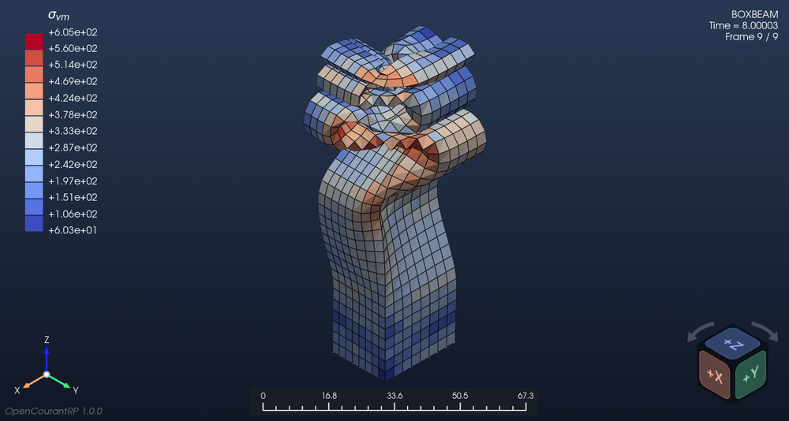

`box_beam_under_impact`: von Mises stress σ<sub>vm</sub> (*max* through the thickness) at the last time step. The rigid wall that crushes the beam is hidden in the Parts tab (*Rigid walls*), so the folds of the shell can be seen.

### Shells: a crushed S-beam

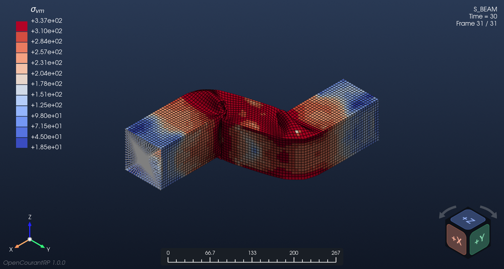

`sbeam_crash`: von Mises stress σ<sub>vm</sub> (*max*) at the last time step. The grey lines at the left end are the rigid body that holds that end (see *Links* in section 6).

### Plastic strain in a tensile coupon

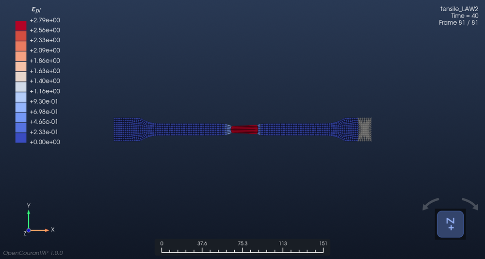

`tensile_test`: equivalent plastic strain ε<sub>pl</sub> in the top view, after the neck has formed in the middle of the specimen. The grey fan at the right is the rigid body that applies the load.

### A notched plate that tears

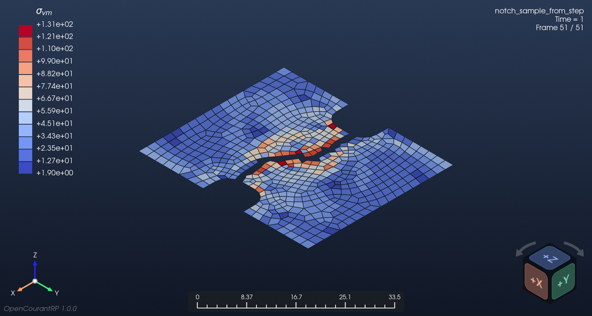

`notch_sample`: von Mises stress σ<sub>vm</sub> (*max*) at the last time step. The eroded elements are not drawn, so the crack that separates the two halves is visible.

### Impact of a rigid ball on a plate

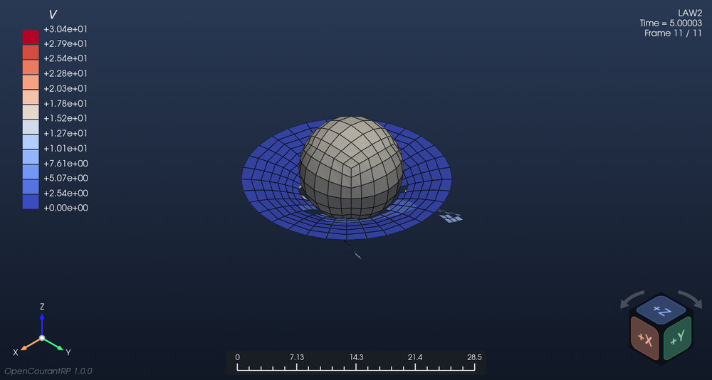

`rigid_ball_impact`: total velocity *V*. The ball is a rigid wall (grey, a fixed color of the Entities tab), and the plate elements that failed are gone.

### A driver airbag

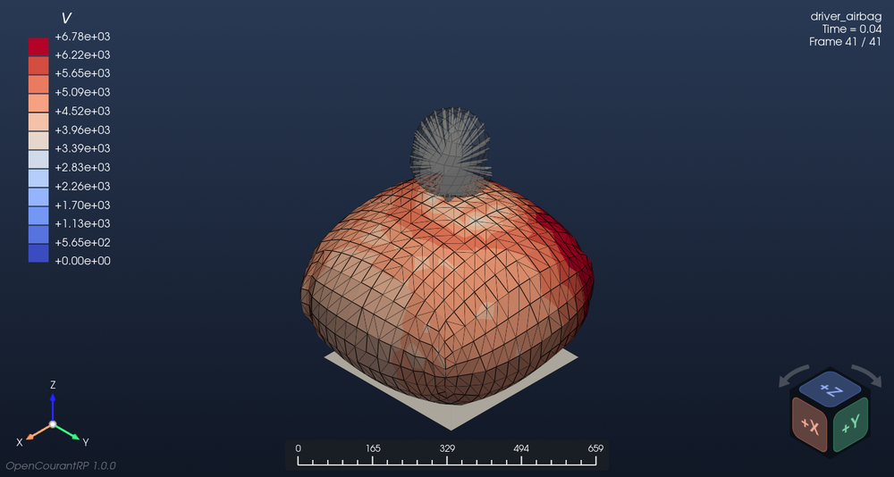

`airbag`: total velocity *V* of the inflated bag. The translucent sphere with lines is the rigid head, drawn with the links of its rigid body (the *Links* button).

### Solids and trusses: a pendulum

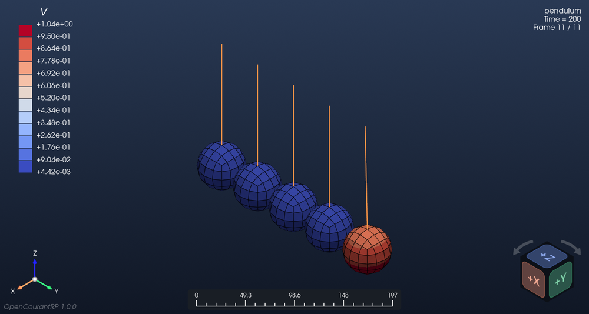

`pendulum`: total velocity *V* of five solid balls hanging from trusses; the truss elements are the orange lines, drawn in their fixed color because they carry no result. The ball at the right has just been hit.

### Fluid: sloshing in a tank

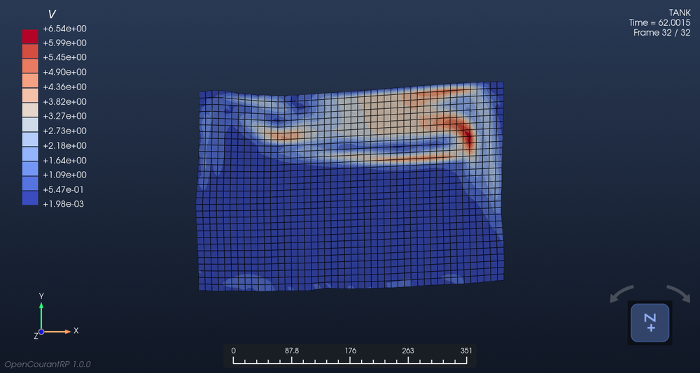

`tank_sloshing`: total velocity *V* of the fluid, top view. This is an ALE model, so *Pressure* and *Density* are also available in the *Element data* group.

The pictures are made by `tools/gallery_shots.py`.

## 18. About and license

OpenCourantRP is free software, licensed under the **GNU Affero General Public License v3 or later**. Copyright 2026 Alejandro Ortiz-Bernardin. Web page: <https://camlab.cl/software/OpenCourantRP/>. Source code and releases: <https://github.com/CAMLAB-UChile/OpenCourantRP>. The line icons are from [Lucide](https://lucide.dev) (ISC license). The OpenCourant solver is included in the installer under its own license.
